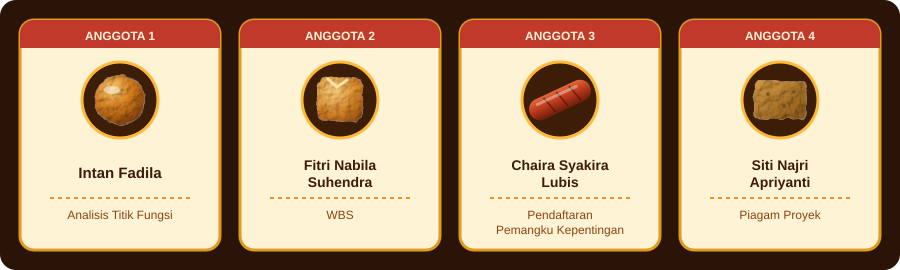
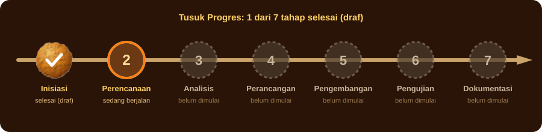

<div align="center">



<br>

[](#tentang)
[](#tim)
[](#tahap)
[](#jadwal)
[](#planning)
[](#dokumen)
[](#cara-kerja)


**Merencanakan model digital sederhana untuk usaha Kak Linda: pesanan, stok, dan penjualan tahu bakso, tempe, sosis, dan bakso goreng.**

</div>


<a id="tentang"></a>
## 🍢 Tentang Proyek

> 🎯 **TUJUAN:** merencanakan digital twin sederhana supaya pesanan di usaha Kak Linda tidak lagi terlupa dan datanya lebih rapi.
> 🧑‍🍳 **TIM:** Kelompok 12, 4 orang.
> 📍 **POSISI SAAT INI:** tahap perencanaan. Dokumen awal dan Tahap 2 (jadwal, manday, biaya, risiko) sudah berupa draf. Berikutnya analisis kebutuhan.

Kak Linda menjual tahu bakso, tempe, sosis, dan bakso goreng. Pesanan masuk secara langsung, pencatatan memakai buku, dan kesulitan yang dirasakan adalah pesanan sering lupa.

Kelompok kami **merencanakan** model digital usaha yang memuat pesanan, stok, dan penjualan. Website pemesanan direncanakan menjadi salah satu jalur masuk pesanan.

| Kondisi | Kebutuhan | Solusi yang direncanakan |
|---|---|---|
| Pesanan masuk langsung, dicatat di buku, pesanan sering lupa | Pesanan, stok, dan penjualan tercatat jelas | Model digital usaha dengan website pemesanan sebagai salah satu jalur pesanan |

<details>
<summary><b>🧺 Produk Kak Linda (klik untuk membuka)</b></summary>

<br>

| Produk | Keterangan |
|---|---|
| Tahu bakso | Dijual saat ini |
| Tempe | Dijual saat ini |
| Sosis | Dijual saat ini |
| Bakso goreng | Dijual saat ini |
| Harga dan data lain | [ISI dari wawancara lanjutan] |

</details>


<a id="tim"></a>
## 👥 Tim Kelompok 12

<div align="center">

</div>

| No | Nama | NIM | GitHub | Peran utama |
|:-:|---|---|---|---|
| 1 | Intan Fadila | 230504074 | intan-ui | Analisis Titik Fungsi |
| 2 | Fitri Nabila Suhendra | 230504056 | fitrinabila-gif | WBS |
| 3 | Chaira Syakira Lubis | 230504064 | narashaa | Pendaftaran Pemangku Kepentingan |
| 4 | Siti Najri Apriyanti | 230504073 | stnajriapriyanti-dot | Piagam Proyek |

**Ketua kelompok:** [ISI]
**Program studi:** Informatika | **Universitas:** Universitas Samudra
**Mata kuliah:** Manajemen Proyek Perangkat Lunak | **Dosen:** Cut Alna


<a id="tahap"></a>
## 🔥 Tusuk Progres

<div align="center">

</div>

Klik tiap tahap untuk melihat isinya. Kode mengikuti [WBS](docs/04-wbs.md).

<details>
<summary><b>1 · Inisiasi</b> &nbsp; ✅ selesai (draf)</summary>

<br>

- **1.1** Wawancara dan observasi
- **1.2** Latar belakang dan ide
- **1.3** Project Charter
- **1.4** Stakeholder Register

📄 [Latar Belakang dan Ide](docs/01-latar-belakang-dan-ide-proyek.md) · [Project Charter](docs/02-project-charter.md) · [Stakeholder Register](docs/03-stakeholder-register.md)
🧑‍🍳 Penanggung jawab: Siti Najri Apriyanti, Chaira Syakira Lubis, semua anggota (1.1)

</details>

<details>
<summary><b>2 · Perencanaan</b> &nbsp; ✅ selesai (draf)</summary>

<br>

- **2.1** WBS
- **2.2** Jadwal dan manday
- **2.3** Biaya dan risiko
- **2.4** Persiapan GitHub

📄 [WBS](docs/04-wbs.md) · [Git dan GitHub](docs/05-git-dan-github.md) · [Jadwal Gantt](docs/tahap-2-project-planning/jadwal-gantt.md) · [Manday](docs/tahap-2-project-planning/effort-manday.md) · [Biaya](docs/tahap-2-project-planning/estimasi-biaya.md) · [Risiko](docs/tahap-2-project-planning/risk-register.md)
🧑‍🍳 Penanggung jawab: Fitri Nabila Suhendra, Chaira Syakira Lubis, semua anggota (2.4)

</details>

<details>
<summary><b>3 · Analisis Kebutuhan</b> &nbsp; 🔥 berikutnya</summary>

<br>

- **3.1** Daftar kebutuhan
- **3.2** Analisis Titik Fungsi
- **3.3** Validasi dengan Kak Linda

🧑‍🍳 Penanggung jawab: Chaira Syakira Lubis, Intan Fadila

</details>

<details>
<summary><b>4 · Perancangan</b> &nbsp; 🔒 belum dimulai</summary>

<br>

- **4.1** Alur proses usaha
- **4.2** Rancangan data
- **4.3** Rancangan tampilan

🧑‍🍳 Penanggung jawab: Fitri Nabila Suhendra, Intan Fadila, Siti Najri Apriyanti

</details>

<details>
<summary><b>5 · Pengembangan</b> &nbsp; 🔒 belum dimulai</summary>

<br>

- **5.1** Pencatatan pesanan
- **5.2** Pencatatan stok
- **5.3** Penjualan dan ringkasan
- **5.4** Website pemesanan

🧑‍🍳 Penanggung jawab: Intan Fadila, Fitri Nabila Suhendra, Chaira Syakira Lubis, Siti Najri Apriyanti

</details>

<details>
<summary><b>6 · Pengujian</b> &nbsp; 🔒 belum dimulai</summary>

<br>

- **6.1** Rencana uji
- **6.2** Pelaksanaan uji
- **6.3** Uji dengan Kak Linda
- **6.4** Perbaikan

🧑‍🍳 Penanggung jawab: Fitri Nabila Suhendra, Chaira Syakira Lubis, Intan Fadila, semua anggota (6.2)

</details>

<details>
<summary><b>7 · Dokumentasi</b> &nbsp; 🔒 belum dimulai</summary>

<br>

- **7.1** Panduan pengguna
- **7.2** Laporan akhir
- **7.3** Bahan presentasi
- **7.4** Arsip repositori

🧑‍🍳 Penanggung jawab: Siti Najri Apriyanti, Fitri Nabila Suhendra, Chaira Syakira Lubis, Intan Fadila

</details>


<a id="jadwal"></a>
## 📅 Jadwal

| Tonggak | Tenggat | Pekerjaan terakhir selesai | Status |
|---|---|---|---|
| MS1 · Tahap 2 Project Planning dikumpulkan | 24 Oktober 2026 | 20 Oktober 2026 | Draf selesai |
| MS2 · Analisis dan perancangan selesai | 13 November 2026 | 10 November 2026 | Belum dimulai |
| MS3 · Pengembangan dan pengujian selesai | 4 Desember 2026 | 1 Desember 2026 | Belum dimulai |
| MS4 · Tenggat akhir proyek | 18 Desember 2026 | 11 Desember 2026 | Belum dimulai |

> Tanggal mulai dan tenggat adalah **asumsi kelompok**. Ganti di sheet Info pada Excel, lalu jadwal terhitung ulang. [ISI tenggat resmi]


<a id="planning"></a>
## 📊 Project Planning (Tahap 2)

| Keluaran | Berkas |
|---|---|
| Jadwal dan Gantt Chart | [jadwal-gantt.md](docs/tahap-2-project-planning/jadwal-gantt.md) |
| Resource dan Responsibility Plan | [resource-plan.md](docs/tahap-2-project-planning/resource-plan.md) |
| Estimasi Usaha (Manday, PERT) | [effort-manday.md](docs/tahap-2-project-planning/effort-manday.md) |
| Estimasi Biaya | [estimasi-biaya.md](docs/tahap-2-project-planning/estimasi-biaya.md) |
| Risk Register | [risk-register.md](docs/tahap-2-project-planning/risk-register.md) |
| Excel lengkap (rumus hidup) | [Tahap2_Project_Planning_Bakso_Kak_Linda.xlsx](docs/tahap-2-project-planning/Tahap2_Project_Planning_Bakso_Kak_Linda.xlsx) |
| Halaman interaktif | [index.html](index.html) (aktifkan GitHub Pages: Settings > Pages > Branch main, folder root) |

Ringkasan: 26 aktivitas, 83,7 manday, tanggal selesai 11 Desember 2026, biaya tunai Rp 643.500, total termasuk nilai setara tenaga kerja Rp 8.419.125, 2 risiko Tinggi.


<a id="dokumen"></a>
## 📄 Dokumen

| No | Dokumen | Isi | Penanggung jawab | Status |
|:-:|---|---|---|---|
| 1 | [Latar Belakang dan Ide Proyek](docs/01-latar-belakang-dan-ide-proyek.md) | Latar belakang, wawancara, masalah, alternatif ide, tujuan | Siti Najri Apriyanti | Draf |
| 2 | [Project Charter](docs/02-project-charter.md) | Piagam proyek, risiko awal, tonggak | Siti Najri Apriyanti | Draf |
| 3 | [Stakeholder Register](docs/03-stakeholder-register.md) | Pemangku kepentingan, matriks, rencana komunikasi | Chaira Syakira Lubis | Draf |
| 4 | [WBS](docs/04-wbs.md) | Rincian pekerjaan dan pembagian tugas | Fitri Nabila Suhendra | Draf |
| 5 | [Git dan GitHub](docs/05-git-dan-github.md) | Istilah, perintah, alur kerja, cara unggah | Semua anggota | Draf |
| 6 | [Project Planning (Tahap 2)](docs/tahap-2-project-planning/jadwal-gantt.md) | Jadwal, resource, manday, biaya, risiko | Semua anggota | Draf |
| 7 | Analisis Titik Fungsi | Ukuran pekerjaan | Intan Fadila | Belum dimulai |

<details>
<summary><b>📁 Isi repositori</b></summary>

```text
.
├── README.md
├── assets/
│   ├── banner.svg
│   ├── divider.svg
│   ├── team.svg
│   └── levels.svg
├── index.html
└── docs/
    ├── 01-latar-belakang-dan-ide-proyek.md
    ├── 02-project-charter.md
    ├── 03-stakeholder-register.md
    ├── 04-wbs.md
    ├── 05-git-dan-github.md
    └── tahap-2-project-planning/
        ├── jadwal-gantt.md
        ├── resource-plan.md
        ├── effort-manday.md
        ├── estimasi-biaya.md
        ├── risk-register.md
        └── Tahap2_Project_Planning_Bakso_Kak_Linda.xlsx
```

</details>


<a id="cara-kerja"></a>
## 🤝 Cara Kerja Tim

1. Ambil pembaruan terbaru: `git pull origin main`.
2. Buat branch per tugas, contoh `wbs-fitri`.
3. Commit dengan pesan jelas, lalu `git push`.
4. Buka Pull Request, minta satu anggota lain memeriksa.
5. Catat tugas di Issues dengan kode WBS, contoh `[2.1] Susun WBS`.

Aturan lengkap ada di [Git dan GitHub](docs/05-git-dan-github.md).

<div align="center"><sub>Kelompok 12 • Informatika • Universitas Samudra</sub></div>
