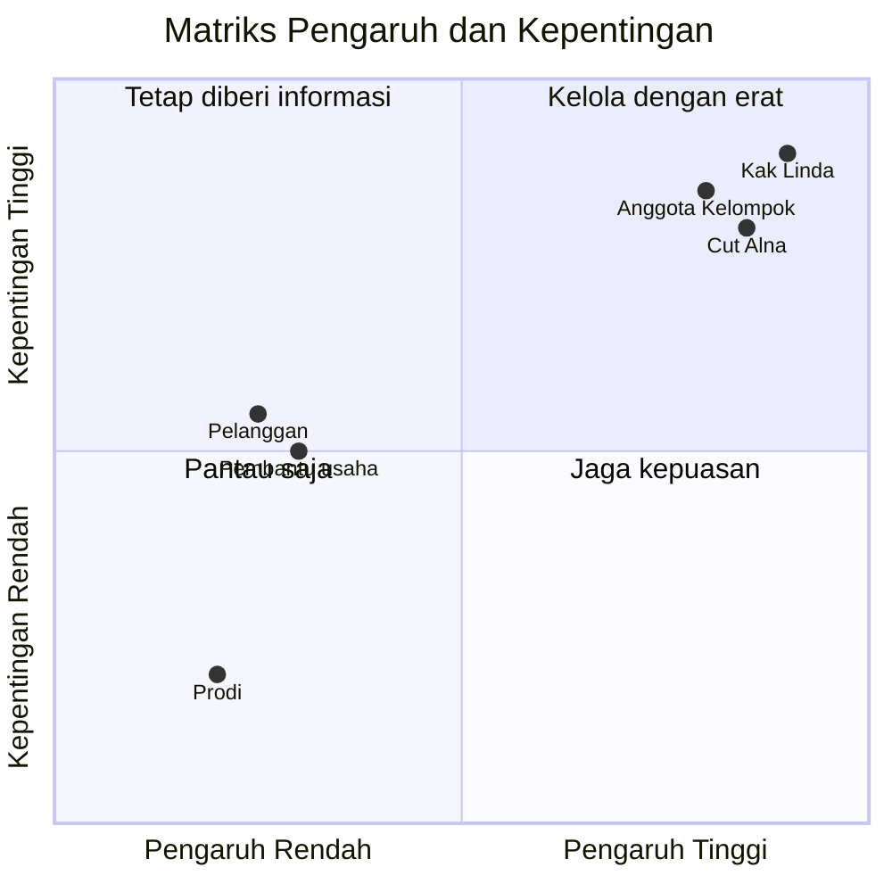

# 03 - Stakeholder Register (Pendaftaran Pemangku Kepentingan)

Penanggung jawab dokumen: Chaira Syakira Lubis.
Daftar ini mengikuti [Project Charter](02-project-charter.md). Penilaian pengaruh dan kepentingan adalah **pendapat awal kelompok**.

## 1. Daftar Stakeholder

| Kode | Stakeholder | Peran | Kepentingan | Kebutuhan / harapan | Pengaruh |
|---|---|---|---|---|---|
| S1 | Kak Linda | Pemilik usaha, pengguna utama | Tinggi | Pesanan tidak lupa dan data usaha rapi. Harapan lain [ISI] | Tinggi |
| S2 | Cut Alna | Dosen penilai | Tinggi | Proyek sesuai kaidah manajemen proyek dan tepat waktu | Tinggi |
| S3 | Anggota Kelompok 12 | Pelaksana proyek | Tinggi | Pembagian tugas jelas dan nilai baik | Tinggi |
| S4 | Pelanggan Kak Linda | Pemesan produk (jika website dipakai) | Sedang | Cara memesan yang mudah | Rendah |
| S5 | Pembantu usaha | Membantu produksi/penjualan, jika ada | Sedang | Cara kerja tidak makin rumit. [ISI, pastikan ada atau tidak] | Rendah |
| S6 | Program Studi Informatika | Penyelenggara mata kuliah | Rendah | Tugas sesuai ketentuan kampus | Rendah |

## 2. Matriks Pengaruh dan Kepentingan

| Kuadran | Stakeholder | Strategi |
|---|---|---|
| Kelola dengan erat | S1, S2, S3 | Libatkan dan laporkan secara rutin |
| Tetap diberi informasi | S4, S5 | Minta masukan saat uji coba |
| Pantau saja | S6 | Ikuti ketentuan umum |

## 3. Rencana Komunikasi (Usulan)

| Stakeholder | Tujuan | Cara | Frekuensi | Penanggung jawab |
|---|---|---|---|---|
| Kak Linda | Menggali kebutuhan, validasi, uji coba | Bertemu langsung, WhatsApp | Setiap tahap, atau sesuai kesepakatan [ISI] | [ISI] |
| Cut Alna | Konsultasi dan pengumpulan tugas | Perkuliahan, pesan resmi | Sesuai jadwal kuliah | Ketua [ISI] |
| Anggota kelompok | Koordinasi tugas | Grup chat, GitHub Issues | Mingguan, rapat singkat [ISI hari] | Semua |
| Pelanggan | Masukan saat uji coba | Tanya langsung | Saat uji coba | [ISI] |
| Pembantu usaha | Masukan cara kerja | Tanya langsung | Saat uji coba | [ISI] |

Lanjut ke [WBS](04-wbs.md).
