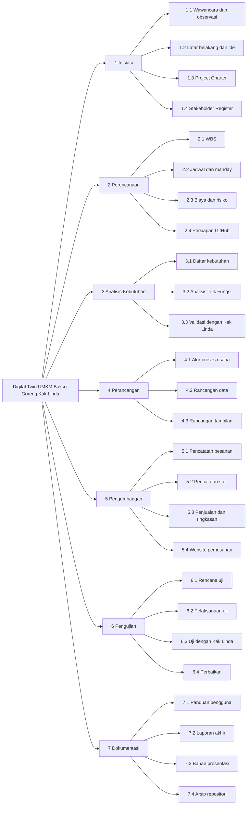

# 04 - Work Breakdown Structure (WBS)

Penanggung jawab dokumen: Fitri Nabila Suhendra.
WBS dibuat dari [Project Charter](02-project-charter.md). Seluruh isi masih **rencana** dan bisa berubah setelah wawancara lanjutan.

## 1. Diagram WBS

## 2. Uraian Tiap Tahap

| Kode | Tahap | Uraian | Hasil |
|---|---|---|---|
| 1 | Inisiasi | Menggali kondisi usaha dan menentukan arah proyek | Latar belakang, Charter, Stakeholder Register |
| 2 | Perencanaan | Menyusun rencana kerja, jadwal, biaya, risiko, dan menyiapkan GitHub | WBS, rencana jadwal, repositori |
| 3 | Analisis Kebutuhan | Merinci apa yang dibutuhkan Kak Linda dan mengukur ukuran pekerjaan | Daftar kebutuhan, hasil Analisis Titik Fungsi |
| 4 | Perancangan | Menggambarkan alur usaha, data, dan tampilan | Rancangan yang disetujui |
| 5 | Pengembangan | Membuat modul pesanan, stok, penjualan, dan website pemesanan | Prototipe |
| 6 | Pengujian | Menguji prototipe, termasuk bersama Kak Linda | Hasil uji dan perbaikan |
| 7 | Dokumentasi | Menyusun panduan, laporan akhir, dan bahan presentasi | Dokumen akhir |

## 3. Keterkaitan Antartahap

| Tahap | Bergantung pada | Alasan |
|---|---|---|
| 2 Perencanaan | 1 Inisiasi | Rencana butuh ruang lingkup dari Charter |
| 3 Analisis Kebutuhan | 1 dan 2 | Kebutuhan digali dari hasil wawancara dan stakeholder |
| 4 Perancangan | 3 | Rancangan mengikuti kebutuhan yang sudah divalidasi |
| 5 Pengembangan | 4 | Pembuatan mengikuti rancangan |
| 6 Pengujian | 5 | Yang diuji adalah hasil pengembangan |
| 7 Dokumentasi | 6 | Panduan dan laporan memuat hasil uji. Sebagian dokumen ditulis sejak awal |

## 4. Pembagian Tugas Anggota (Usulan)

| Kode WBS | Pekerjaan | Penanggung jawab |
|---|---|---|
| 1.1 | Wawancara dan observasi | Semua anggota |
| 1.2 | Latar belakang dan ide | Siti Najri Apriyanti |
| 1.3 | Project Charter | Siti Najri Apriyanti |
| 1.4 | Stakeholder Register | Chaira Syakira Lubis |
| 2.1 | WBS | Fitri Nabila Suhendra |
| 2.2 | Jadwal dan manday | Fitri Nabila Suhendra |
| 2.3 | Biaya dan risiko | Chaira Syakira Lubis |
| 2.4 | Persiapan GitHub | Semua anggota |
| 3.1 | Daftar kebutuhan | Chaira Syakira Lubis |
| 3.2 | Analisis Titik Fungsi | Intan Fadila |
| 3.3 | Validasi dengan Kak Linda | Intan Fadila |
| 4.1 | Alur proses usaha | Fitri Nabila Suhendra |
| 4.2 | Rancangan data | Intan Fadila |
| 4.3 | Rancangan tampilan | Siti Najri Apriyanti |
| 5.1 | Pencatatan pesanan | Intan Fadila |
| 5.2 | Pencatatan stok | Fitri Nabila Suhendra |
| 5.3 | Penjualan dan ringkasan | Chaira Syakira Lubis |
| 5.4 | Website pemesanan | Siti Najri Apriyanti |
| 6.1 | Rencana uji | Fitri Nabila Suhendra |
| 6.2 | Pelaksanaan uji | Semua anggota |
| 6.3 | Uji dengan Kak Linda | Chaira Syakira Lubis |
| 6.4 | Perbaikan | Intan Fadila |
| 7.1 | Panduan pengguna | Siti Najri Apriyanti |
| 7.2 | Laporan akhir | Fitri Nabila Suhendra |
| 7.3 | Bahan presentasi | Chaira Syakira Lubis |
| 7.4 | Arsip repositori | Intan Fadila |

Pembagian di tahap 5 sampai 7 masih usulan dan akan disesuaikan setelah analisis kebutuhan.

Lanjut ke [Pemahaman Git dan GitHub](05-git-dan-github.md).
