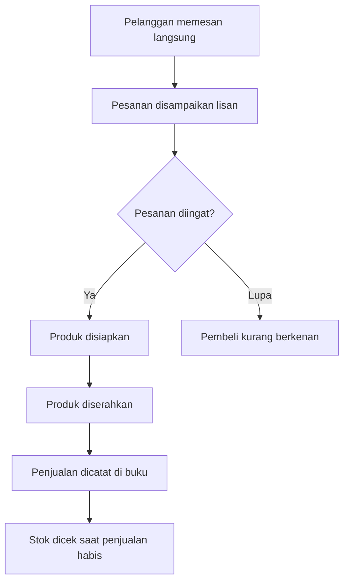
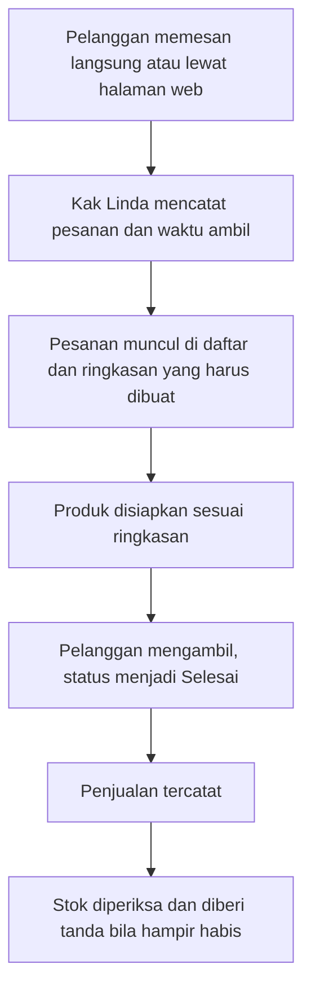

# 07 - Alur Proses Usaha (WBS 4.1)

Penanggung jawab: Fitri Nabila Suhendra | Status: draf, posisi 31 Oktober 2026

## 1. Alur Saat Ini

Berdasarkan wawancara, pesanan masuk langsung, pencatatan memakai buku, dan stok dicek saat penjualan habis. Urutan rincinya masih dugaan dan perlu dikonfirmasi `[KONFIRMASI Kak Linda]`.

## 2. Alur yang Direncanakan

## 3. Titik Perubahan

| Langkah | Sekarang | Direncanakan | Masalah yang dijawab |
|---|---|---|---|
| Menerima pesanan | Lisan | Dicatat dengan waktu ambil | Pesanan lupa |
| Menyiapkan produk | Mengandalkan ingatan | Mengikuti ringkasan jumlah per produk | Pembeli kurang berkenan |
| Mencatat penjualan | Buku | Tercatat dari status Selesai | Catatan sulit dilihat ringkasannya |
| Memeriksa stok | Saat sudah habis | Ditandai lebih awal | Stok tidak terpantau |

Alur ini sengaja memakai langkah sesedikit mungkin karena Kak Linda bekerja sendiri dan belum memahami aplikasi.

Lanjut ke [Rancangan Tampilan](08-rancangan-tampilan.md). Kembali ke [README](../README.md).
