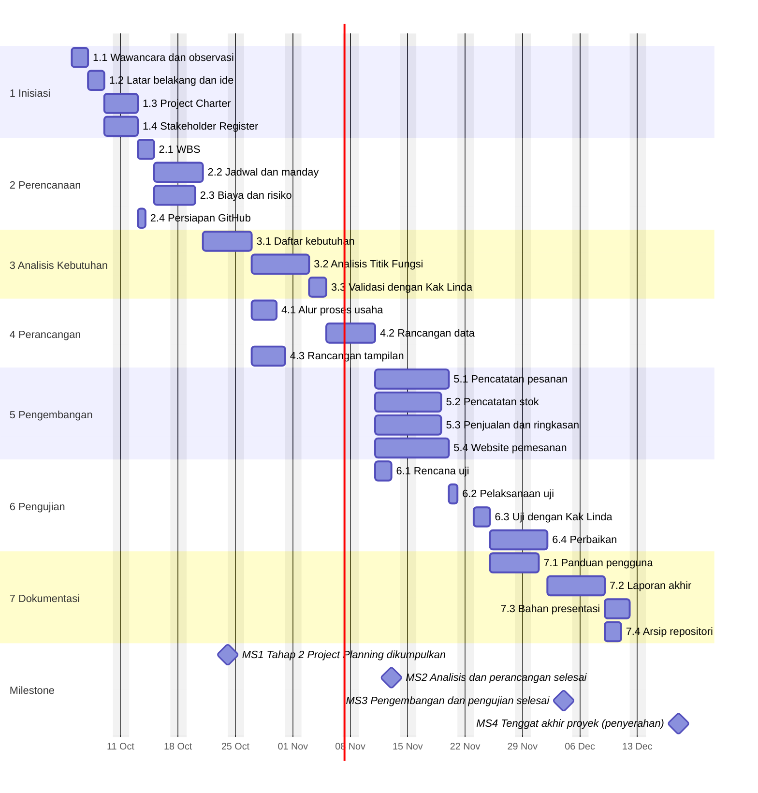

# Jadwal Proyek dan Gantt Chart

Tahap 2 - Project Planning | Kelompok 12

Jadwal ini dihitung dari durasi dan dependensi di [Excel Tahap 2](Tahap2_Project_Planning_Bakso_Kak_Linda.xlsx). Hari kerja Senin-Jumat, libur 25 Des 2026 dan 1 Jan 2027 dikecualikan. FS = selesai-ke-mulai, SS = mulai-ke-mulai.

> **Asumsi:** tanggal mulai (5 Okt 2026), tenggat Tahap 2 (24 Okt 2026), dan tenggat akhir (18 Des 2026) adalah asumsi kelompok. Ganti di sheet Info, jadwal akan terhitung ulang. [ISI tenggat resmi]

## Gantt

Catatan: Mermaid di GitHub tidak mengenal libur nasional, sehingga bar di sekitar 25 Des bisa tampak bergeser satu hari. Tanggal yang berlaku ada di tabel dan Excel.

## Daftar Aktivitas

| Kode | Aktivitas | Pelaksana | Manday | Durasi (hari) | Pred | Mulai | Selesai | Status |
|---|---|---|---:|---:|---|---|---|---|
| 1.1 | Wawancara dan observasi | Intan, Fitri, Chaira, Siti | 4.17 | 2 | - | 05 Okt 2026 | 06 Okt 2026 | Berjalan, data masih [ISI] |
| 1.2 | Latar belakang dan ide | Siti | 1.58 | 2 | 1.1 FS | 07 Okt 2026 | 08 Okt 2026 | Draf selesai |
| 1.3 | Project Charter | Siti | 1.58 | 2 | 1.2 FS | 09 Okt 2026 | 12 Okt 2026 | Draf selesai |
| 1.4 | Stakeholder Register | Chaira | 1.67 | 2 | 1.2 FS | 09 Okt 2026 | 12 Okt 2026 | Draf selesai |
| 2.1 | WBS | Fitri | 1.58 | 2 | 1.3 FS | 13 Okt 2026 | 14 Okt 2026 | Draf selesai |
| 2.2 | Jadwal dan manday | Fitri | 3.17 | 4 | 2.1 FS | 15 Okt 2026 | 20 Okt 2026 | Draf selesai |
| 2.3 | Biaya dan risiko | Chaira | 3.00 | 3 | 2.1 FS | 15 Okt 2026 | 19 Okt 2026 | Draf selesai |
| 2.4 | Persiapan GitHub | Intan, Fitri, Chaira, Siti | 1.08 | 1 | 1.3 FS | 13 Okt 2026 | 13 Okt 2026 | Draf selesai |
| 3.1 | Daftar kebutuhan | Chaira | 3.17 | 4 | 2.2 FS | 21 Okt 2026 | 26 Okt 2026 | Belum dimulai |
| 3.2 | Analisis Titik Fungsi | Intan | 4.33 | 5 | 3.1 FS | 27 Okt 2026 | 02 Nov 2026 | Belum dimulai |
| 3.3 | Validasi dengan Kak Linda | Intan | 2.00 | 2 | 3.2 FS | 03 Nov 2026 | 04 Nov 2026 | Belum dimulai |
| 4.1 | Alur proses usaha | Fitri | 3.00 | 3 | 3.1 FS | 27 Okt 2026 | 29 Okt 2026 | Belum dimulai |
| 4.2 | Rancangan data | Intan | 3.17 | 4 | 3.3 FS | 05 Nov 2026 | 10 Nov 2026 | Belum dimulai |
| 4.3 | Rancangan tampilan | Siti | 3.17 | 4 | 4.1 SS | 27 Okt 2026 | 30 Okt 2026 | Belum dimulai |
| 5.1 | Pencatatan pesanan | Intan | 6.17 | 7 | 4.2 FS | 11 Nov 2026 | 19 Nov 2026 | Belum dimulai |
| 5.2 | Pencatatan stok | Fitri | 5.17 | 6 | 4.2 FS | 11 Nov 2026 | 18 Nov 2026 | Belum dimulai |
| 5.3 | Penjualan dan ringkasan | Chaira | 5.17 | 6 | 4.2 FS | 11 Nov 2026 | 18 Nov 2026 | Belum dimulai |
| 5.4 | Website pemesanan | Siti | 6.33 | 7 | 4.2 FS | 11 Nov 2026 | 19 Nov 2026 | Belum dimulai |
| 6.1 | Rencana uji | Fitri | 2.00 | 2 | 5.1 SS | 11 Nov 2026 | 12 Nov 2026 | Belum dimulai |
| 6.2 | Pelaksanaan uji | Intan, Fitri, Chaira, Siti | 3.17 | 1 | 5.1 FS | 20 Nov 2026 | 20 Nov 2026 | Belum dimulai |
| 6.3 | Uji dengan Kak Linda | Chaira | 2.00 | 2 | 6.2 FS | 23 Nov 2026 | 24 Nov 2026 | Belum dimulai |
| 6.4 | Perbaikan | Intan | 4.17 | 5 | 6.3 FS | 25 Nov 2026 | 01 Des 2026 | Belum dimulai |
| 7.1 | Panduan pengguna | Siti | 3.17 | 4 | 6.3 FS | 25 Nov 2026 | 30 Nov 2026 | Belum dimulai |
| 7.2 | Laporan akhir | Fitri | 5.00 | 5 | 6.4 FS | 02 Des 2026 | 08 Des 2026 | Belum dimulai |
| 7.3 | Bahan presentasi | Chaira | 3.00 | 3 | 7.2 FS | 09 Des 2026 | 11 Des 2026 | Belum dimulai |
| 7.4 | Arsip repositori | Intan | 1.67 | 2 | 7.2 FS | 09 Des 2026 | 10 Des 2026 | Belum dimulai |

## Milestone dan Cek Tenggat

| Kode | Milestone | Tenggat | Selesai terakhir | Selisih (hari) | Status |
|---|---|---|---|---:|---|
| MS1 | Tahap 2 Project Planning dikumpulkan | 24 Okt 2026 | 20 Okt 2026 | 4 | OK |
| MS2 | Analisis dan perancangan selesai | 13 Nov 2026 | 10 Nov 2026 | 3 | OK |
| MS3 | Pengembangan dan pengujian selesai | 04 Des 2026 | 01 Des 2026 | 3 | OK |
| MS4 | Tenggat akhir proyek (penyerahan) | 18 Des 2026 | 11 Des 2026 | 7 | OK |

Seluruh pekerjaan selesai pada 11 Des 2026, sebelum tenggat akhir.

Kembali ke [README](../../README.md).