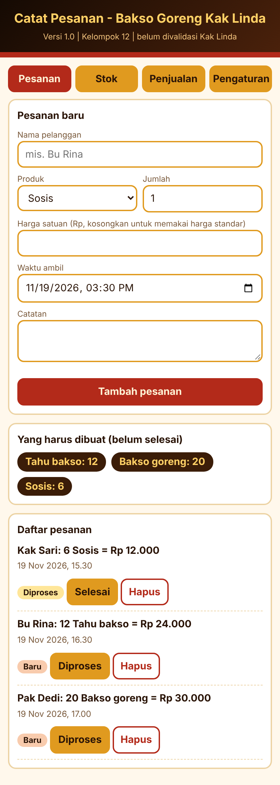
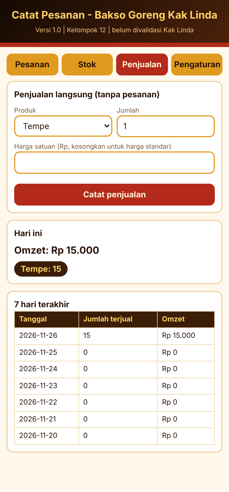

# Dokumentasi Proyek dan Hasil Pengujian

Tahap 5 - Project Closure | Kelompok 12 | Informatika, Universitas Samudra  
Dosen: Cut Alna Fadhilla, S.Kom., M.Sc.  
Posisi data: 19 November 2026

## 1. Produk Akhir

**Catat Pesanan v1.0** ([prototipe/catat-pesanan.html](../../prototipe/catat-pesanan.html)) adalah satu halaman web yang dibuka di HP atau komputer. Data tersimpan di peramban perangkat yang dipakai. Produk ini adalah **prototipe**, belum divalidasi Kak Linda.

| Kebutuhan ([Dokumen 06](../06-daftar-kebutuhan.md)) | Status di v1.0 |
|---|---|
| F1 Mencatat pesanan (pelanggan, produk, jumlah, waktu ambil, catatan) | Ada |
| F2 Daftar pesanan berurutan waktu dengan status Baru, Diproses, Selesai | Ada |
| F3 Ringkasan jumlah per produk yang harus dibuat | Ada |
| F4 Harga satuan dan total pesanan | Ada |
| F5 Penjualan harian, penjualan langsung, ringkasan 7 hari | Ada |
| F6 Stok dan tanda hampir habis | Ada |
| F7 Pemesanan oleh pelanggan lewat website | **Belum dikerjakan** (prioritas Tambahan) |

Tangkapan layar (data contoh untuk pengujian, bukan data usaha Kak Linda):

## 2. Panduan Penggunaan Singkat (WBS 7.1)

1. **Isi harga standar:** buka tab Pengaturan, isi harga tiap produk (menurut Kak Linda sekitar Rp 1.000 sampai Rp 2.000, harga tepat [ISI]).
2. **Isi stok:** buka tab Stok, isi stok sekarang dan batas minimal tiap produk. Bila stok mencapai batas, muncul tanda merah di bagian atas.
3. **Catat pesanan:** di tab Pesanan isi nama, produk, jumlah, dan waktu ambil, lalu tekan Tambah pesanan.
4. **Lihat yang harus dibuat:** kotak "Yang harus dibuat" menjumlahkan semua pesanan yang belum selesai per produk.
5. **Ubah status:** tekan Diproses saat mulai membuat, lalu Selesai saat pesanan diambil. Saat Selesai, penjualan tercatat dan stok berkurang otomatis.
6. **Penjualan tanpa pesanan:** di tab Penjualan isi produk dan jumlah, lalu tekan Catat penjualan.
7. **Cadangan:** di tab Pengaturan tekan Unduh cadangan secara berkala. Berkas cadangan bisa dipulihkan lewat kolom Pulihkan.

Catatan: data hanya ada di perangkat dan peramban yang dipakai. Menghapus data peramban akan menghapus catatan bila belum ada cadangan.

## 3. Hasil Pengujian

Pengujian dilakukan oleh kelompok pembuat pada 19 November 2026, dengan dua cara: pengujian logika (Node.js) dan pengujian tampilan di peramban Chromium tanpa tampilan (Playwright). **Ini bukan uji penerimaan pengguna.**

### 3.1 Pengujian logika: 20 dari 20 lulus

| Kode | Skenario | Hasil |
|---|---|---|
| UJ-01 | Tambah pesanan valid | Lulus |
| UJ-02 | Tolak nama kosong | Lulus |
| UJ-03 | Tolak jumlah 0, negatif, dan pecahan | Lulus |
| UJ-04 | Tolak produk tidak dikenal | Lulus |
| UJ-05 | Status Baru, Diproses, Selesai berurutan | Lulus |
| UJ-06 | Pesanan Selesai tidak bisa dimajukan lagi dan tidak menggandakan penjualan | Lulus |
| UJ-07 | Penjualan memakai harga pesanan | Lulus |
| UJ-08 | Harga kosong memakai harga standar produk | Lulus |
| UJ-09 | Stok berkurang saat Selesai dan tidak di bawah 0 | Lulus |
| UJ-10 | Hapus pesanan Selesai mengembalikan stok dan membatalkan penjualan | Lulus |
| UJ-11 | Penjualan langsung tercatat dan mengurangi stok | Lulus |
| UJ-12 | Penjualan langsung menolak jumlah tidak valid | Lulus |
| UJ-13 | Peringatan stok hampir habis | Lulus |
| UJ-14 | Daftar pesanan berurutan waktu ambil | Lulus |
| UJ-15 | Ringkasan harus dibuat tidak memuat pesanan Selesai | Lulus |
| UJ-16 | Omzet dan jumlah terjual per hari | Lulus |
| UJ-17 | Pencadangan dan pemulihan data (bolak-balik) | Lulus |
| UJ-18 | Pemulihan menolak data rusak | Lulus |
| UJ-19 | Nomor id pesanan dan penjualan tidak bentrok | Lulus |
| UJ-20 | Setel stok menolak nilai negatif | Lulus |

### 3.2 Pengujian tampilan: 10 dari 10 lulus

| Kode | Skenario | Hasil |
|---|---|---|
| UI-01 | Pesan kesalahan muncul bila nama kosong | Lulus |
| UI-02 | Pesanan masuk daftar dan ringkasan | Lulus |
| UI-03 | Status berubah menjadi Diproses | Lulus |
| UI-04 | Status berubah menjadi Selesai dan ringkasan kosong | Lulus |
| UI-05 | Peringatan stok hampir habis muncul (stok 4, batas 5) | Lulus |
| UI-06 | Omzet hari ini = Rp 12.000 | Lulus |
| UI-07 | Penjualan langsung menambah omzet menjadi Rp 15.000 | Lulus |
| UI-08 | Data tetap ada setelah halaman dimuat ulang | Lulus |
| UI-09 | Nama berisi HTML ditampilkan sebagai teks (aman) | Lulus |
| UI-10 | Tidak ada galat skrip di konsol | Lulus |

### 3.3 Temuan selama pengujian

| No | Temuan | Tindakan | Status |
|---|---|---|---|
| 1 | Pada pengujian tampilan pertama, peringatan stok hampir habis tidak muncul (UI-05). Penyebab: kolom stok ikut digambar ulang saat nilai diubah sehingga isian batas minimal hilang. | Kolom stok tidak lagi digambar ulang saat diubah. Pengujian diulang dan lulus. | Selesai |
| 2 | Tombol menu Pengaturan hampir terpotong di layar sempit. | Ukuran tombol menu disesuaikan. | Selesai |

## 4. Uji Penerimaan dengan Kak Linda (WBS 6.3)

**Status: belum dilakukan.** Kak Linda belum memahami aplikasi dan mengikuti usulan kelompok, sehingga uji dilakukan lewat demo langsung di HP. Lembar berikut diisi saat demo benar-benar terjadi.

| No | Tugas yang dicoba Kak Linda | Berhasil sendiri? | Perlu bantuan? | Catatan |
|---|---|---|---|---|
| 1 | Mencatat satu pesanan | ✓ |  |  |
| 2 | Melihat ringkasan yang harus dibuat | ✓ |  |  |
| 3 | Mengubah status pesanan sampai Selesai | ✓ |  |  |
| 4 | Mencatat penjualan langsung |  |  | ✓ |
| 5 | Mengisi stok dan memahami tanda hampir habis | ✓ |  |  |

Tanggal demo: [ISI]. Komentar Kak Linda: [ISI].

## 5. Daftar Dokumentasi Proyek

| Kelompok | Berkas |
|---|---|
| Inisiasi | [Latar belakang dan ide](../01-latar-belakang-dan-ide-proyek.md), [Project Charter](../02-project-charter.md), [Stakeholder Register](../03-stakeholder-register.md) |
| Perencanaan | [WBS](../04-wbs.md), [Git dan GitHub](../05-git-dan-github.md), [Jadwal](../tahap-2-project-planning/jadwal-gantt.md), [Resource](../tahap-2-project-planning/resource-plan.md), [Manday](../tahap-2-project-planning/effort-manday.md), [Biaya](../tahap-2-project-planning/estimasi-biaya.md), [Risiko](../tahap-2-project-planning/risk-register.md), [Excel Tahap 2](../tahap-2-project-planning/Tahap2_Project_Planning_Bakso_Kak_Linda.xlsx) |
| Analisis dan perancangan | [Daftar kebutuhan](../06-daftar-kebutuhan.md), [Alur proses](../07-alur-proses.md), [Rancangan tampilan](../08-rancangan-tampilan.md) |
| Pelaksanaan | [Laporan Project Execution](../tahap-3-project-execution/laporan-project-execution.md), [Prototipe](../../prototipe/catat-pesanan.html) |
| Monitoring | [Laporan Monitoring dan Controlling](../tahap-4-monitoring-controlling/laporan-monitoring-controlling.md), [Excel Tahap 4](../tahap-4-monitoring-controlling/Tahap4_Monitoring_Controlling.xlsx) |
| Penutupan | [Evaluasi pencapaian](evaluasi-pencapaian.md), [Lessons learned](lessons-learned.md), [Laporan akhir](laporan-akhir.md) |

Kembali ke [README](../../README.md).
